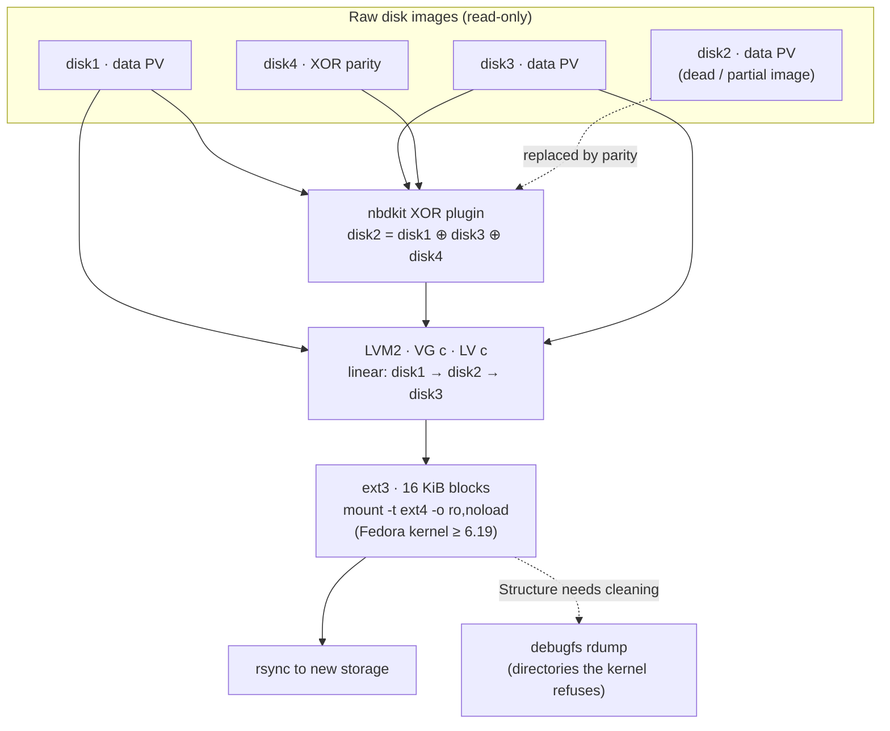

# Recovering data from a NETGEAR ReadyNAS NV+ (v1, SPARC) on Fedora

A field-tested, read-only procedure for getting files off the original **Infrant / NETGEAR
ReadyNAS NV+** (the SPARC-based model, RAIDiator 4.x) when the box is dead and one of the
four disks is unreadable. Everything runs in a **Fedora** VM on an ordinary x86-64 host,
works from raw disk images, and never writes a single byte to them.

Fedora is used because its kernel (≥ 6.19) can mount the box's unusual 16 KiB-block ext3
natively. On distributions with older kernels you're stuck with userspace `fuse2fs`, which
was **~5× slower** in practice (16 vs 77 MB/s), the difference between a day and a week on
a few terabytes.

It was written after recovering ~4.4 TB / 145,000 files from a 4 × 2 TB X-RAID unit where
one disk could only be imaged up to ~600 MB. Every file except three that were being
written at the moment of the crash came back.

It covers two cases:

- **All disks work** (the box itself died: PSU, board, firmware). Skip the parity steps; see
  [All disks healthy – the short path](#all-disks-healthy--the-short-path).
- **One disk is dead or unreadable.** Rebuild it exactly from the XOR parity disk; follow
  the full procedure.

> **Not the ARM "NV+ v2".** That model uses ordinary Linux md-raid and can be assembled
> with `mdadm`. This guide is for the older SPARC unit only.

---

## Contents

- [What is actually on the disks](#what-is-actually-on-the-disks)
- [Set up the Fedora VM](#set-up-the-fedora-vm)
- [All disks healthy – the short path](#all-disks-healthy--the-short-path)
- [Step 0 – Image the disks](#step-0--image-the-disks)
- [Step 1 – Attach the images read-only](#step-1--attach-the-images-read-only)
- [Step 2 – Identify the layout](#step-2--identify-the-layout)
- [Step 3 – Prove the parity hypothesis](#step-3--prove-the-parity-hypothesis)
- [Step 4 – Rebuild the missing disk](#step-4--rebuild-the-missing-disk)
- [Step 5 – Activate LVM read-only](#step-5--activate-lvm-read-only)
- [Step 6 – Mount the filesystem](#step-6--mount-the-filesystem)
- [Step 7 – Optional: check consistency](#step-7--optional-check-consistency)
- [Step 8 – Copy the data off](#step-8--copy-the-data-off)
- [Step 9 – Rescue the stragglers with debugfs](#step-9--rescue-the-stragglers-with-debugfs)
- [Step 10 – Tear down](#step-10--tear-down)
- [Troubleshooting](#troubleshooting)
- [Dead ends (so you can skip them)](#dead-ends-so-you-can-skip-them)

---

## What is actually on the disks

Much of what is written online about this box is wrong. On the unit recovered here, the
stack was:



| Layer | What it is | Why it matters |
|---|---|---|
| Partitions | MBR: p1 ≈ 2 GB OS (ext3, mirrored with no md superblock), p2 swap, p3 extended, **p5 data** (type `8e`) | All disks share the same layout, so one disk's offsets apply to all |
| RAID | **Infrant's own X-RAID: no md at all.** Data disks are plain LVM PVs; the last disk is a **dedicated XOR parity disk** | `mdadm --examine` finds nothing. Any one disk can be rebuilt as the XOR of the others |
| Volume | **LVM2 text-format** metadata (despite 2009-era firmware), VG `c`, one LV `c` laid out **linearly** across the data PVs | Modern `lvm2` reads it fine; no LVM1 tools needed |
| Filesystem | **ext3 with a 16 KiB block size**, little-endian | x86 kernels before 6.19 cannot mount it, hence Fedora |

**Endianness:** the CPU was big-endian SPARC, but ext3 metadata is always little-endian on
disk and LVM metadata is text, so an x86 host reads everything natively. Only md 0.90
superblocks would have been host-endian, and this unit doesn't use md.

> ⚠️ This was verified on one 4-bay unit. Check your own disks in steps 2–3 before trusting
> any of it. If `mdadm --examine` *does* find superblocks on your data partitions, your unit
> is different and you need an md-based approach instead.

---

## Set up the Fedora VM

### Create the VM

- **Image:** latest Fedora (44 at the time of writing), *Everything* **Network Install**
  ISO for x86_64. In the installer choose **Fedora Custom Operating System** (minimal); no
  extra package groups are needed.
- **Hardware:** 4 vCPU, 8 GB RAM, 20 GB disk. Nothing large is stored locally.
- **Must be a VM**, not a container: loop devices with partitions and the `nbd` kernel
  module need a real kernel.
- Put it on a network that can reach the storage holding the images.

### Update and check the kernel

```bash
sudo -i
dnf upgrade -y && reboot
uname -r            # must be 6.19 or newer
```

### Install the tools

```bash
dnf install -y lvm2 mdadm e2fsprogs nbdkit nbdkit-python-plugin nbd \
               python3-numpy nfs-utils rsync tmux git ddrescue testdisk
git clone https://github.com/viktormar1337/readynas-nvplus-recovery.git
cd readynas-nvplus-recovery
```

### Two Fedora specifics

- **LVM devices file.** Fedora's LVM only scans devices listed in
  `/etc/lvm/devices/system.devices`, so it ignores loop and nbd devices. Every
  `pvs`/`vgs`/`lvs`/`vgchange` in this guide therefore carries `--devicesfile ""`.
- **SELinux.** If nbdkit or a mount is denied with permission errors that make no sense,
  `setenforce 0` for the duration of the recovery.

### Make the images available

Over NFS, mount the image share **read-only**, and the destination separately read-write:

```bash
mkdir -p /mnt/images /mnt/dest
mount -t nfs -o ro  nas.example:/export/images /mnt/images
mount -t nfs        nas.example:/export/dest   /mnt/dest
IMG=/mnt/images
```

On ZFS-based NAS systems (TrueNAS etc.), child datasets are **not** visible through a
parent's NFS export. They show up as empty directories. Export the dataset that actually
contains the images.

You need free space at the destination at least equal to the used space on the old volume.

---

## All disks healthy – the short path

If every disk images cleanly, nothing needs reconstructing. The parity disk isn't part of
the LVM volume at all, so you simply attach the **data** disks and skip steps 3–4.

```bash
losetup -rP --find --show $IMG/disk1.img
losetup -rP --find --show $IMG/disk2.img
losetup -rP --find --show $IMG/disk3.img
# disk4 = parity: not needed, don't attach it
```

Then continue at [Step 5](#step-5--activate-lvm-read-only). `pvs` should list every PV with
no `[unknown]`.

Which disk is parity? The one whose p5 **doesn't** show a clean `LVM2_member` with a
readable UUID in `blkid`, and whose partition table usually doesn't parse either. The
metadata printed by `verify-parity.py --metadata` lists the PVs that belong to the volume.

**Optional parity check.** On a consistent array the XOR of *all* disks (data + parity) is
zero. Run `verify-parity.py` with all of them: the XOR line should show no label (`-`).
If it shows `LABELONE` instead, parity is stale. That doesn't matter while all data disks
are healthy, but don't count on it for a rebuild later.

```bash
./scripts/verify-parity.py --offset 4608003 $IMG/disk1.img $IMG/disk2.img $IMG/disk3.img $IMG/disk4.img
```

Also keep in mind: with all four disks you **have** redundancy during the copy. If a data
disk image later turns out to have unreadable areas (ddrescue mapfile with bad sectors),
you can switch to the rebuild path for that disk and get those areas back from parity.

---

## Step 0 – Image the disks

Work from images, never the original drives. Pull the disks, connect them to the Fedora
host (or any Linux box) and image each one with `ddrescue`; a mapfile lets you resume and
retry bad areas:

```bash
ddrescue -n    /dev/sdX disk1.img disk1.map   # fast pass
ddrescue -d -r3 /dev/sdX disk1.img disk1.map  # retry bad areas
```

A disk that dies part-way is fine: as long as all **other** disks image cleanly, the
missing one can be reconstructed from parity. A partial image of the dead disk is useless
for assembly but worth keeping.

---

## Step 1 – Attach the images read-only

```bash
losetup -rP --find --show $IMG/disk1.img    # -r read-only, -P scan partitions
losetup -rP --find --show $IMG/disk3.img
lsblk -o NAME,SIZE,RO,PTTYPE
```

This is the dead-disk case (disk2 dead here). Leave out the dead disk's image; don't glob
`disk*.img`. With all disks healthy, see the [short path](#all-disks-healthy--the-short-path).

It's normal for the parity disk to show **no partition table**: its MBR is the XOR of the
others' MBRs and no longer parses. You don't need to attach it as a loop device at all.

---

## Step 2 – Identify the layout

```bash
fdisk -l /dev/loop0
blkid /dev/loop0p*
mdadm --examine /dev/loop0p5         # expect: "No md superblock detected"
pvs --devicesfile ""
vgs --devicesfile ""
lvs --devicesfile "" -a -o lv_name,vg_name,lv_size,segtype,devices
```

Note the **start sector and length of p5** from `fdisk`. On the unit tested here they were
`4608003` and `3902384303` (2 TB disks); yours may differ with other disk sizes.

What you should see:

- `blkid` reports p5 as `LVM2_member`.
- `vgs` shows VG `c` with one PV **missing**, last written to some old device name such as
  `/dev/hde5`.
- `lvs` shows LV `c` as `linear`, spread over the PVs with one `[unknown]` among them.

Ignore LVM's suggestions to run `vgck --updatemetadata` or update the "old PV header". Both
would write to the disks.

---

## Step 3 – Prove the parity hypothesis

Before trusting anything, show that the missing disk really is the XOR of the others.
Pass **all surviving disks including the parity disk**:

```bash
./scripts/verify-parity.py --offset 4608003 $IMG/disk1.img $IMG/disk3.img $IMG/disk4.img
./scripts/verify-parity.py --offset 4608003 --metadata $IMG/disk1.img
```

Expected output:

```
disk1.img   LABELONE  uuid='AAAAAA-...-111111'
disk3.img   LABELONE  uuid='BBBBBB-...-222222'
disk4.img   LABELONE  uuid='<garbage>'               # parity: label survives, UUID doesn't
XOR of all  LABELONE  uuid='CCCCCC-...-333333'       # = the PV LVM says is missing
```

If the XOR line shows the UUID of the missing PV, the hypothesis holds and reconstruction
is exact. `--metadata` prints the VG layout: the order of the PVs in the LV is the order
you'll see the data in.

The parity disk shows `LABELONE` because the label bytes are identical on every data disk,
so their XOR is the label itself. UUIDs differ per disk and turn into noise.

---

## Step 4 – Rebuild the missing disk

Two options. Both give identical bytes.

### Option A – on the fly with nbdkit (no extra disk space)

```bash
nbdkit -r python ./scripts/xor-reconstruct.py \
  images=$IMG/disk1.img,$IMG/disk3.img,$IMG/disk4.img \
  offset=4608003 size=3902384303
modprobe nbd
nbd-client -b 512 localhost /dev/nbd0
blkid /dev/nbd0      # LVM2_member, UUID = the missing PV
```

`nbd-client` prints a warning about the oldstyle protocol; it's harmless. If `nbd-client -c
/dev/nbd0` still says disconnected, use `qemu-nbd` instead (`dnf install -y qemu-img`):

```bash
qemu-nbd --connect=/dev/nbd0 --read-only nbd://localhost:10809
```

The plugin reads the three sources in parallel, XORs them with numpy and prefetches when
reads are sequential. Measured at ~190 MB/s raw on 10 GbE NFS.

### Option B – write it out once as an image

Costs one disk's worth of space, but removes nbdkit from the chain and leaves you with a
permanent copy:

```bash
./scripts/make-missing-disk.py --offset 4608003 --size 3902384303 \
  --out /mnt/dest/disk2-p5.img $IMG/disk1.img $IMG/disk3.img $IMG/disk4.img
losetup -r --find --show /mnt/dest/disk2-p5.img
```

Resumable: rerun the same command after an interruption.

---

## Step 5 – Activate LVM read-only

```bash
pvs --devicesfile ""                 # all PVs present, no [unknown]
vgchange -ay --devicesfile "" \
  --config 'activation { read_only_volume_list = [ "c/c" ] }' c
lvs --devicesfile "" -o lv_name,lv_attr c     # attr must contain 'r'
```

Raise readahead. It helps a lot over network storage:

```bash
blockdev --setra 32768 $(readlink -f /dev/c/c) /dev/nbd0 /dev/loop0 /dev/loop1
```

---

## Step 6 – Mount the filesystem

Check the superblock first:

```bash
dumpe2fs -h /dev/c/c | grep -Ei 'block size|features|state'
```

`Block size: 16384` is expected. `Filesystem state: not clean` is expected after a crash.
If `needs_recovery` is **not** in the features list, there is nothing in the journal to
replay.

```bash
mkdir -p /mnt/readynas
mount -t ext4 -o ro,noload /dev/c/c /mnt/readynas
dmesg | tail -5
ls /mnt/readynas
```

`noload` skips the journal. That's safe when `needs_recovery` isn't set. Expect roughly
70–80 MB/s on large files over 10 GbE NFS, measured with:

```bash
dd if="/mnt/readynas/some/large/file" of=/dev/null bs=1M count=512 status=progress
```

If the journal *does* need replaying, do it on a copy-on-write overlay so the images stay
untouched:

```bash
truncate -s 8G /var/tmp/c.cow
COW=$(losetup --find --show /var/tmp/c.cow)
dmsetup create c-ov --table "0 $(blockdev --getsz /dev/c/c) snapshot /dev/c/c $COW N 8"
e2fsck -E journal_only -y /dev/mapper/c-ov
mount -t ext4 -o ro /dev/mapper/c-ov /mnt/readynas
```

---

## Step 7 – Optional: check consistency

A read-only fsck over the whole volume is the strongest evidence that the reconstructed
disk is correct. A wrong reconstruction produces a flood of errors starting where that
disk's part of the LV begins.

```bash
e2fsck -fn -C 0 /dev/c/c 2>&1 | tee e2fsck.log
```

It's slow over the network (hours). If it gets well into the reconstructed region with
only a few isolated errors, you can stop it and move on. A handful like
`i_blocks is X, should be Y` on files written at the moment of the crash is normal.

---

## Step 8 – Copy the data off

Run it in `tmux`; it takes a while.

```bash
rsync -rltH --info=progress2 --partial --ignore-errors \
  /mnt/readynas/ /mnt/dest/recovered/ 2>&1 | tee rsync.log
```

`-rltH` copies content, symlinks, timestamps and hard links, but not owners, permissions,
ACLs or xattrs. The old box's UIDs mean nothing on new storage, and on ZFS datasets with
NFSv4 ACLs (`aclmode=restricted`, the TrueNAS default for SMB shares) copying permissions
fails anyway. Harmless leftover noise like `failed to set permissions on …` can be filtered
out afterwards:

```bash
grep -iE 'error|failed' rsync.log | grep -v 'failed to set permissions'
```

The command is resumable. Verify completeness with a dry run when it's done:

```bash
rsync -rltHn --stats /mnt/readynas/ /mnt/dest/recovered/ | grep 'files transferred'
```

---

## Step 9 – Rescue the stragglers with debugfs

Some paths may fail with **`Structure needs cleaning (117)`**. `dmesg` tells you why:

```bash
dmesg | grep 'EXT4-fs error'
```

### `casefold flag without casefold feature` → fully recoverable

Old firmware set inode flag bit `0x40000000`, which modern ext4 interprets as
case-insensitive directory and refuses to open on a filesystem without that feature. The
data is fine. `debugfs` doesn't care about the flag:

```bash
debugfs -c -R 'rdump "/path/to/dir" /mnt/dest/recovered-debugfs/parent' /dev/c/c
```

(`Operation not permitted while setting permissions` messages are the same ACL noise as
above; the files are written.)

### `deleted inode referenced` → usually lost

Directory entries that point to inodes that were never written. These are the files being
written when the box died. Check:

```bash
debugfs -c -R 'ls -l "/path/to/dir"' /dev/c/c
debugfs -c -R 'stat <inode>' /dev/c/c
```

If `stat` shows size 0, no blocks and a 1970 timestamp, there's no metadata left to follow.
You can try carving with `photorec` on the region after the last successfully written file
in the same directory (`debugfs -R 'blocks <inode>'` gives its blocks, a 16 KiB block group
holds 131072 blocks; `photorec` is in the `testdisk` package), but don't expect much. The data most likely never reached the disk.

---

## Step 10 – Tear down

```bash
umount /mnt/readynas
vgchange -an --devicesfile "" c
nbd-client -d /dev/nbd0          # or: qemu-nbd --disconnect /dev/nbd0
pkill nbdkit
losetup -D
umount /mnt/dest /mnt/images
```

Keep the images of all surviving disks until you've checked the copy. Without them the
missing disk can't be rebuilt again.

---

## Troubleshooting

| Symptom | Cause | Fix |
|---|---|---|
| `mount.nfs: failed to apply fstab options` | Not root | `sudo -i` |
| NFS share shows empty subdirectories | ZFS child datasets aren't exported through the parent | Export the child dataset itself |
| `pvs` doesn't see loop/nbd PVs | Fedora LVM devices file | Add `--devicesfile ""` |
| `Can't lookup blockdev` on mount | VG not activated | `vgchange -ay --devicesfile "" ...` |
| nbdkit or mount denied for no obvious reason | SELinux | `setenforce 0` |
| `uname -r` older than 6.19 | VM not updated | `dnf upgrade -y && reboot` |
| `blkid /dev/nbd0` empty | nbd-client not connected | `nbd-client -c /dev/nbd0`; reconnect; or `qemu-nbd --connect=/dev/nbd0 --read-only nbd://localhost:10809` |
| `nbdkit` at 100 % CPU, fsck/rsync slow | Prefetch reading far more than consumed | Compare `rchar` in `/proc/$(pidof nbdkit)/io` with the consumer's `read_bytes`. Should be ~3× |
| rsync `--chown` has no effect | `--chown` requires `-o -g` | Use `-rltHog --chown=UID:GID` |

---

## Dead ends (so you can skip them)

- **Assuming md-raid.** X-RAID v1 on this box is not md. `mdadm` finds nothing and `--update=byteorder` is irrelevant.
- **Assuming LVM1.** The metadata is LVM2 text format; current lvm2 reads it directly.
- **Assembling with the partial image of the dead disk.** It would be treated as a full member and inject zeros. Leave it out and rebuild from parity.
- **Generic "nearby read = sequential" prefetch heuristics** in the XOR layer: fsck's scattered reads triggered ~2000× read amplification. The plugin here only prefetches after consecutive forward reads.
- **Older distributions with fuse2fs.** Debian 13 (kernel 6.12) can only read the volume through `fuse2fs`, which handles one request at a time and topped out at ~16 MB/s. Debian's backports kernel wasn't installable at the time. That's why this guide is Fedora-only.

---

## Scripts

| Script | Purpose |
|---|---|
| [`scripts/verify-parity.py`](scripts/verify-parity.py) | Show LVM labels/UUIDs per disk and of their XOR; dump the VG metadata |
| [`scripts/xor-reconstruct.py`](scripts/xor-reconstruct.py) | nbdkit plugin: missing disk = XOR of the others, on the fly |
| [`scripts/make-missing-disk.py`](scripts/make-missing-disk.py) | Write the missing disk's data partition out as an image (resumable) |

All three are tested against synthetic images with a known missing disk: reconstruction is
byte-identical, including after a hard kill and resume.

## License

MIT. See [LICENSE](LICENSE). No warranty: this is data recovery, so work on images and
keep the originals.
